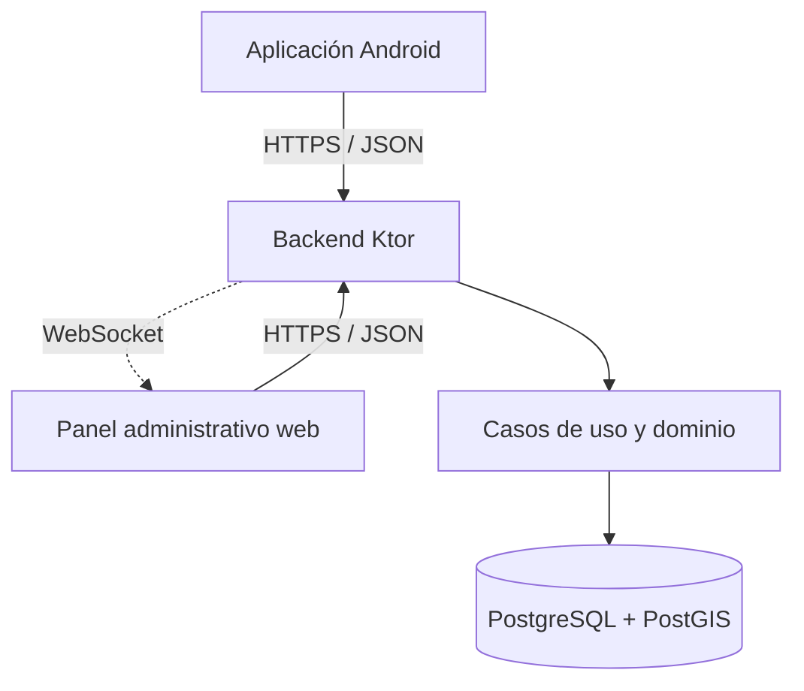

# 1. Arquitectura del backend

Mapa Urbano permite que ciudadanos registren incidencias urbanas y que personal administrativo las gestione. El backend central recibe peticiones de Android y del panel web, valida identidad y reglas de negocio, y persiste información.

## Tecnologías verificadas en el repositorio

| Elemento | Función |
|---|---|
| Kotlin | Lenguaje del servidor |
| Ktor / Netty | Servidor HTTP, rutas y WebSocket |
| Koin | Inyección de dependencias |
| PostgreSQL + PostGIS | Persistencia relacional y coordenadas geográficas |
| Exposed | Acceso a datos desde Kotlin |
| Flyway | Migraciones SQL versionadas |
| HikariCP | Pool de conexiones |
| Gradle y Docker | Construcción y entorno de ejecución |

## Organización

El código se agrupa por funcionalidades y capas. Una ruta API recibe la petición; un caso de uso coordina reglas; el dominio contiene modelos y contratos; infraestructura implementa el acceso a datos. Esta descripción es un modelo de lectura, no una prueba de aislamiento perfecto entre capas.

El servidor expone `/api/v1`, `/swagger` y rutas de salud. Ver `application/Routing.kt`. La fotografía se guarda en la base mediante `BYTEA`, según `docs/ESTADO_ACTUAL_Y_DECISIONES.md`, no en el almacenamiento S3 de propuestas antiguas.

[Volver al índice](README.md)
