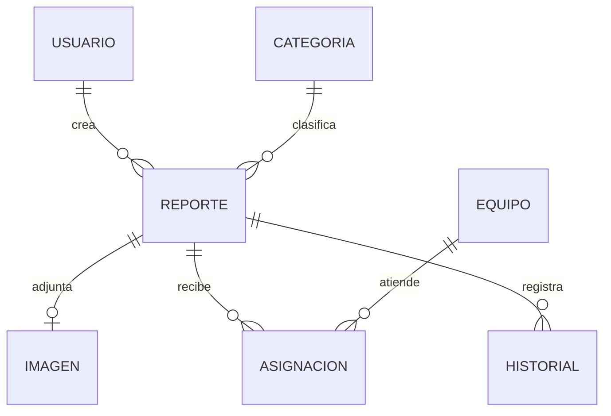

# 4. Modelo conceptual de datos

Este modelo resume relaciones del dominio y **no sustituye** el diagrama físico completo de tablas, columnas y restricciones SQL.

## Entidades conceptuales

- **Usuario:** identidad de vecino y estado de cuenta.
- **Sesión:** permite autenticar peticiones.
- **Reporte:** incidencia con título, descripción, ubicación, categoría, estado, prioridad y fechas.
- **Categoría:** clasifica el tipo de problema.
- **Imagen:** evidencia opcional asociada a un reporte.
- **Equipo / asignación:** organización administrativa de atención.
- **Historial / auditoría:** seguimiento de cambios y acciones.

## Relaciones principales

El diagrama expresa relaciones conceptuales simplificadas: la multiplicidad real y la estructura de tablas deben verificarse en las migraciones SQL. El modelo `reports/domain/Report.kt` incluye `id`, `categoryId`, `userId`, `status`, `priority`, `title`, `description`, `latitude`, `longitude`, `version` y marcas temporales. `userId` es nullable para compatibilidad con reportes anónimos históricos, pero la ruta ciudadana de alta requiere usuario autenticado.

PostGIS agrega capacidades para almacenar y consultar ubicaciones. Flyway administra los cambios de esquema mediante archivos versionados.

[Volver al índice](README.md)
