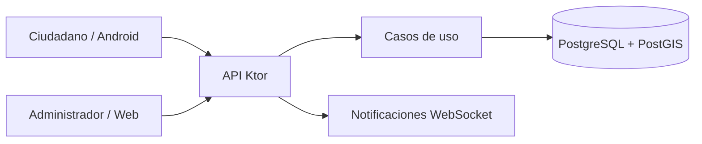
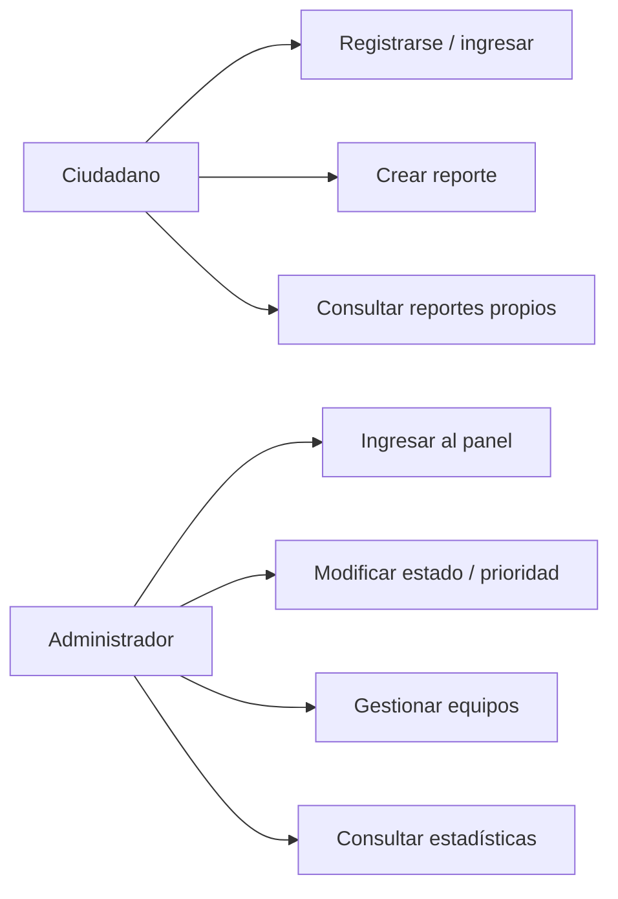
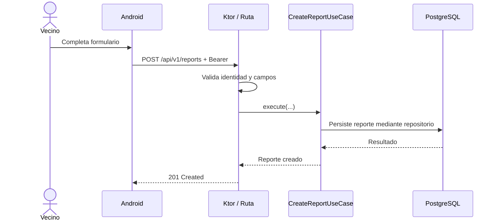

# 5. Diagramas de modelado

Los diagramas Mermaid se visualizan directamente en GitHub. Son modelos didácticos del flujo observado en el código, no una certificación de ejecución de extremo a extremo.

## 5.1 Componentes

## 5.2 Casos de uso (representación funcional)

Este segundo gráfico es un **mapa de casos de uso**, no un diagrama UML formal de óvalos y relaciones `include`/`extend`.

## 5.3 Secuencia: creación de reporte

El tratamiento opcional de imágenes está omitido aquí para mantener legible el flujo principal; ver `reports/api/PublicReportRoutes.kt` y `media/`.

[Volver al índice](README.md)
